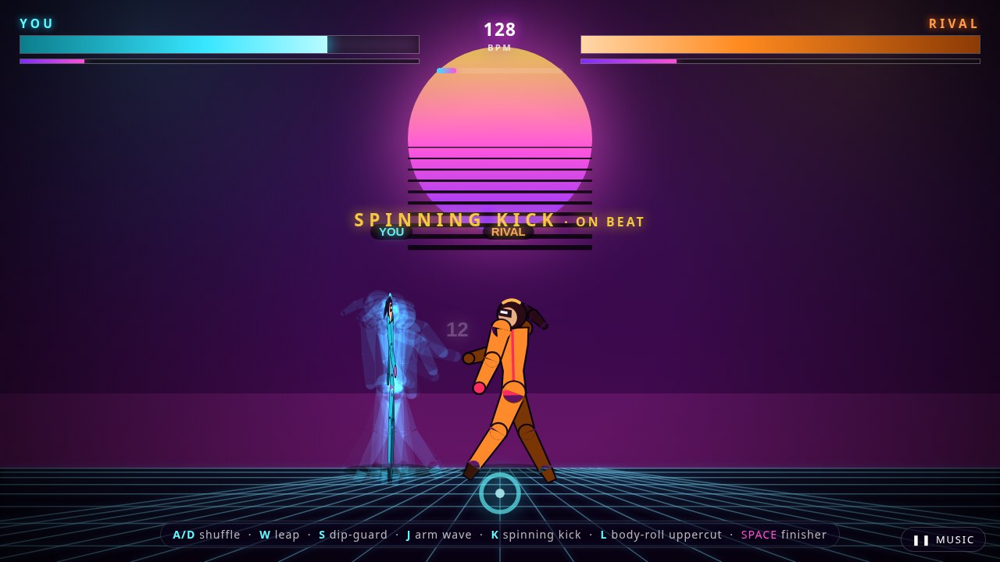

<div align="center">

# Dance Fight

**Every fight move is a dance move.** A single-file browser rhythm game — load your own track, the beat is analysed up front, and every attack you throw is a dance move. Land it in time with the music and it becomes a **PERFECT** hit worth 60% extra damage.

<a href="https://drsamonline.github.io/dance-fight/"></a>
<a href="https://drsamonline.github.io/dance-fight/play/"></a>

<a href="https://github.com/drsamonline/dance-fight/stargazers"></a>
<a href="https://github.com/drsamonline/dance-fight/blob/main/LICENSE"></a>
<a href="https://github.com/drsamonline/dance-fight/commits/main"></a>


**🔗 [Landing page](https://drsamonline.github.io/dance-fight/)** &nbsp;·&nbsp; **🎮 [Play the live demo](https://drsamonline.github.io/dance-fight/play/)** &nbsp;·&nbsp; **[Source](https://github.com/drsamonline/dance-fight)**

**Download:** [Windows (.exe)](https://github.com/drsamonline/dance-fight/releases/latest/download/dance-fight-portable.exe) &nbsp;·&nbsp; [Android (.apk)](https://github.com/drsamonline/dance-fight/releases/latest/download/dance-fight.apk)

</div>

---


<p align="center"><strong>Every fight move is a dance move.</strong></p>

<p align="center">
  Load a track from your device and the character dances to it. The beat is analysed up front,
  the whole arena pulses on the pulse, and every attack you throw is a dance move — land it in
  time with the music and it becomes a <strong>PERFECT</strong> hit worth 60% extra damage.
</p>

<p align="center">
  <a href="https://drsamonline.github.io/dance-fight/play/"></a>
  <a href="LICENSE"></a>
  <a href="https://github.com/drsamonline/dance-fight/stargazers"></a>
  <a href="https://github.com/drsamonline/dance-fight/commits/main"></a>
</p>

<p align="center">
  
  
  
  
  
  
  
</p>

<h3 align="center">▶ <a href="https://drsamonline.github.io/dance-fight/play/">Play it in your browser</a></h3>

<p align="center"></p>

---

## What it is

A single-file browser game. No build step, no dependencies, no install, no server.

```
index.html    # the entire game — HTML, CSS, JS, ~78 KB
```

Open it, pick a song, fight. It works offline and from `file://` too.

### Highlights

- **The music drives everything.** Your track is analysed for its real beat grid, and the character's
  dance is locked to the audio playhead — so it can't drift, and it doesn't depend on frame rate.
- **Every move is a dance move.** Arm Wave, Spinning Kick, Body-Roll Uppercut and a 720° Body-Roll
  Finisher. Spins are real rotations, not pose swaps.
- **The character never stops dancing.** Attack poses are layered *over* the ongoing groove rather than
  replacing it.
- **Rhythm is the combat system.** Moves landed on the beat hit 60% harder and build a bigger combo.
  Shuffle-stepping in time charges your finisher meter.
- **Keyboard and touch.** On-screen controls appear automatically on phones.
- **One file, zero dependencies.** No framework, no bundler, no CDN.

---

## How to play

Pick an audio file (or just press Start and it plays a default 128 BPM groove).

| Key | Move | Notes |
| --- | --- | --- |
| `A` `D` | Shuffle step | Dance-walk. Stepping in time charges your finisher meter |
| `W` | Leap | Arabesque |
| `S` | Dip | Guards and dodges — hold to block |
| `J` | **Arm Wave** | Fast, low damage |
| `K` | **Spinning Kick** | Medium — a full 360° turn |
| `L` | **Body-Roll Uppercut** | Heavy — rolls through a full turn |
| `SPACE` | **Body-Roll Finisher** | Needs a full meter — a 720° spin |
| `P` | Pause / resume music | |

**Land moves on the beat.** A move thrown within ~80 ms of a beat lands as a PERFECT: 1.6× damage and a
bigger combo multiplier. The gold `· ON BEAT` tag on the move name tells you when you nailed it.

**On a phone:** on-screen controls appear automatically. Hold a direction with one thumb and tap attacks
with the other. Rotate to landscape — the arena is wider than it is tall.

---

## How the beat sync works

The interesting part. The usual approach — polling an `AnalyserNode` every frame — ties beat detection to
the render frame rate, which falls apart on a slow device. This game does it **offline instead**, on the
decoded audio buffer, before the fight starts:

1. **Low-pass** the signal to ~180 Hz with a one-pole filter (kick-drum territory).
2. Build a **per-10 ms RMS envelope**, then take its **positive flux**.
3. **Peak-pick** onsets against an adaptive threshold.
4. **Autocorrelate** the flux over lags of 0.30–0.75 s to find the tempo, refined to sub-sample accuracy.
5. Search every phase offset for the **grid that lines up with the most onset energy**.

The result is a beat grid. During play the dance phase is read *straight off the audio playhead* —
`(playhead − phase) / period` — so the groove cannot drift, and it is completely independent of frame rate.

On test tracks at 100, 128 and 150 BPM the detected tempo was exact, and **97% of kicks landed within
30 ms of a grid beat** (median offset 5–9 ms, which is just the 10 ms hop resolution).

Everything else is drawn on a forward-kinematic skeleton. Moves are keyframed joint angles blended *over*
the ongoing dance groove rather than replacing it, so the character keeps dancing while it fights. Spins
are faked as a horizontal squash that mirrors past 90°, with the near and far limbs swapping — and every
attack leaves additive ghost trails of the last few poses, which is what makes a rotation read as motion.

---

## Run it locally

```bash
git clone https://github.com/drsamonline/dance-fight.git
cd dance-fight
open index.html          # macOS   (xdg-open on Linux, start on Windows)
```

No toolchain needed. To serve it instead:

```bash
python3 -m http.server 8000   # then visit http://localhost:8000
```

---

## Known limitations

Being straight about what this is and isn't:

- **Autoplay.** Browsers block audio until you interact with the page, so the first tap or click unlocks
  sound. If you ever hear nothing, a **live level meter** under the BPM readout shows whether audio is
  actually flowing — and a banner appears if it isn't. That meter reads real signal, not a flag.
- **Tempo lock is at load.** A track with a long ambient intro, or one that drifts tempo, gets a grid based
  on the overall character of the song. If no clear pulse is found it falls back to a steady 128 BPM.
- **Mobile is landscape.** It's playable in portrait, but the arena is 16:9 and it will be cramped.
- **Feel is unverified at 60fps.** The geometry, timing and beat grid were verified programmatically, but
  I could only test in a headless browser rendering a few frames per second. How the spins and trails feel
  in motion is the part you're the judge of.

---

<h2 align="center">License</h2>

<p align="center">
  <a href="LICENSE">MIT</a> © Dr Sohil Momin<br>
  Built as a single HTML file. Fork it, remix it, drop your own track in.
</p>
