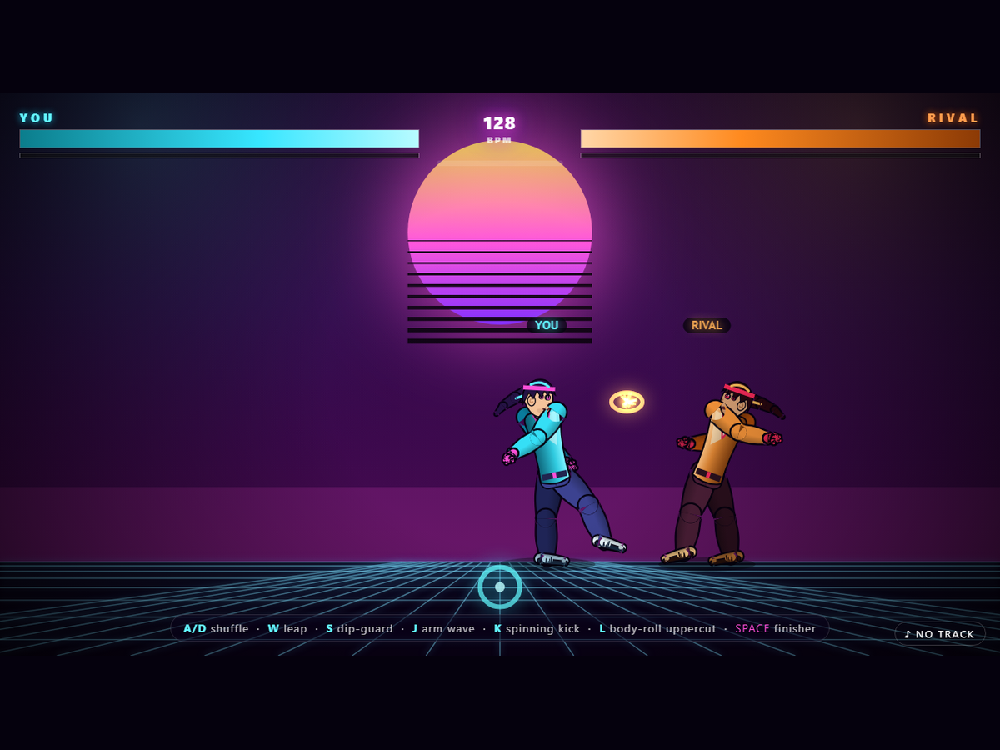
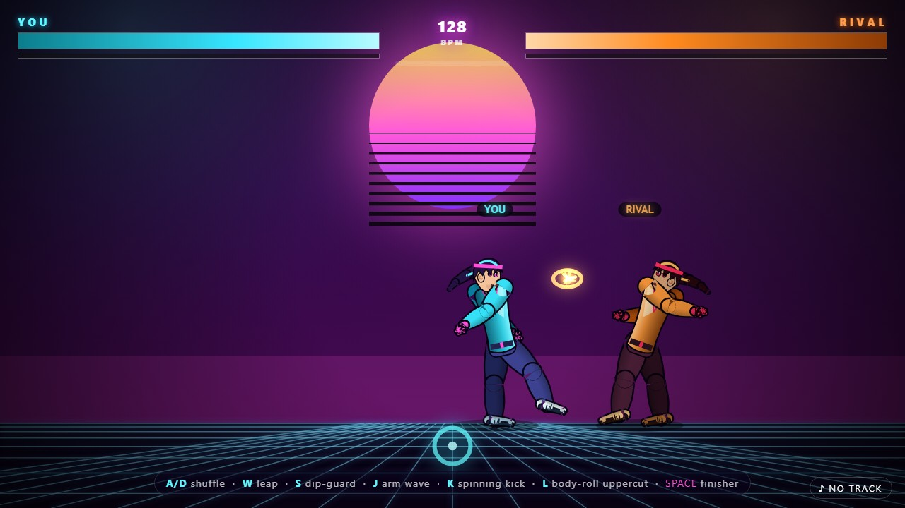

<div align="center">

# Dance Fight

<!-- shot:start -->



<!-- shot:end -->

**Every fight move is a dance move.** A single-file browser rhythm game — load your own track, the beat is analysed up front, and every attack you throw is a dance move. Land it in time with the music and it becomes a **PERFECT** hit worth 60% extra damage.

<a href="https://drsamonline.github.io/dance-fight/"></a>
<a href="https://drsamonline.github.io/dance-fight/play/"></a>
<a href="https://drsamonline.github.io/"></a>

<a href="https://github.com/drsamonline/dance-fight/stargazers"></a>
<a href="https://github.com/drsamonline/dance-fight/blob/main/LICENSE"></a>
<a href="https://github.com/drsamonline/dance-fight/commits/main"></a>


**🔗 [Landing page](https://drsamonline.github.io/dance-fight/)** &nbsp;·&nbsp; **🎮 [Play the live demo](https://drsamonline.github.io/dance-fight/play/)** &nbsp;·&nbsp; **[Source](https://github.com/drsamonline/dance-fight)**

**Download:** [Windows (.exe)](https://github.com/drsamonline/dance-fight/releases/latest/download/dance-fight-portable.exe) &nbsp;·&nbsp; [Android (.apk)](https://github.com/drsamonline/dance-fight/releases/latest/download/dance-fight.apk)

</div>

---


<p align="center"><strong>Every fight move is a dance move.</strong></p>

<p align="center">
  Load a track from your device and the character dances to it. The beat is analysed up front,
  the whole arena pulses on the pulse, and every attack you throw is a dance move — land it in
  time with the music and it becomes a <strong>PERFECT</strong> hit worth 60% extra damage.
</p>

<p align="center">
  <a href="https://drsamonline.github.io/dance-fight/play/"></a>
  <a href="LICENSE"></a>
  <a href="https://github.com/drsamonline/dance-fight/stargazers"></a>
  <a href="https://github.com/drsamonline/dance-fight/commits/main"></a>
</p>

<p align="center">
  
  
  
  
  
  
  
</p>

<h3 align="center">▶ <a href="https://drsamonline.github.io/dance-fight/play/">Play it in your browser</a></h3>

<p align="center"></p>

---

## What it is

A single-file browser game. No build step, no dependencies, no install, no server.

```
docs/play/index.html        # the entire game — HTML, CSS, JS
```

Open that file, pick a song, fight. It works offline and from `file://` too. Served from the
web, it installs as an app: the page registers a service worker that keeps the game playable
with no connection, and `manifest.webmanifest` gives it a name and an icon.

### Highlights

- **The music drives everything.** Your track is analysed for its real beat grid, and the character's
  dance is locked to the audio playhead — so it can't drift, and it doesn't depend on frame rate.
- **Every move is a dance move.** Arm Wave, Spinning Kick, Body-Roll Uppercut and a 720° Body-Roll
  Finisher. Spins are real rotations, not pose swaps.
- **The character never stops dancing.** Attack poses are layered *over* the ongoing groove rather than
  replacing it.
- **Rhythm is the combat system.** Moves landed on the beat hit 60% harder and build a bigger combo.
  Shuffle-stepping in time charges your finisher meter.
- **Keyboard and touch.** On-screen controls appear automatically on phones.
- **One file, zero dependencies.** No framework, no bundler, no CDN.
- **Built for the room you're in.** A click of latency calibration, a rival that telegraphs what
  it is about to do, three difficulty settings, and a visual beat pulse for playing muted.

---

## How to play

Pick an audio file (or just press Start and it plays a default 128 BPM groove).

| Key | Move | Notes |
| --- | --- | --- |
| `A` `D` | Shuffle step | Dance-walk. Stepping in time charges your finisher meter |
| `W` | Leap | Arabesque |
| `S` | Dip | Guards and dodges — hold to block |
| `J` | **Arm Wave** | Fast, low damage |
| `K` | **Spinning Kick** | Medium — a full 360° turn |
| `L` | **Body-Roll Uppercut** | Heavy — rolls through a full turn |
| `SPACE` | **Body-Roll Finisher** | Needs a full meter — a 720° spin |
| `P` | Pause / resume music | |
| `R` | Re-lock the tempo | Re-listens to the next few bars and re-fits the beat grid |

**Land moves on the beat.** A move thrown within ~80 ms of a beat lands as a PERFECT: 1.6× damage and a
bigger combo multiplier. That 80 ms is real time, so it feels the same on a 90 BPM track as on a 170 BPM
one instead of widening and shrinking with the tempo. The gold `· ON BEAT` tag on the move name tells you when you nailed it.

**On a phone:** on-screen controls appear automatically. Hold a direction with one thumb and tap attacks
with the other. Landscape fits the whole arena; portrait crops the empty sides and frames the two dancers
instead of shrinking the 16:9 stage into a thumbnail.

**If your hits feel off,** open the start screen and tap **Tap to calibrate** six times along with the
practice groove (the sound button only drops the volume, so calibration works just as well muted). Each tap measures how far it landed from the nearest beat, and the median becomes your
offset — the judgement window moves to where *you* hear the beat, which is what Bluetooth headphones and
slow output latency need. It is stored locally and can also be dragged by hand from −200 to +200 ms.

**No track handy?** Press **Play** next to *Practice groove* and the game synthesises a four-bar
kick/snare/hat/bass loop at 100, 120, 128 or 140 BPM. Its beat grid is exact by construction, so it is
also the cleanest way to feel what an on-beat hit is supposed to be.

**Difficulty** changes the rival only — how often it commits, how fast it closes, how well it guards and
how hard it hits. Your own damage and the beat scoring are identical on every setting, so a PERFECT is
worth the same on Easy as on Hard. Bests, wins and settings stay on the device; the end screen can draw
the result to a PNG you can share.

---

## How the beat sync works

The interesting part. The usual approach — polling an `AnalyserNode` every frame — ties beat detection to
the render frame rate, which falls apart on a slow device. This game does it **offline instead**, on the
decoded audio buffer, before the fight starts:

1. **Low-pass** the signal to ~180 Hz with a one-pole filter (kick-drum territory).
2. Build a **per-10 ms RMS envelope**, then take its **positive flux**.
3. **Peak-pick** onsets against an adaptive threshold.
4. **Autocorrelate** the flux over lags of 0.30–0.75 s to find the tempo, refined to sub-sample accuracy.
5. Search every phase offset for the **grid that lines up with the most onset energy**.

The result is a beat grid. During play the dance phase is read *straight off the audio playhead* —
`(playhead − phase) / period` — so the groove cannot drift, and it is completely independent of frame rate.

On test tracks at 100, 128 and 150 BPM the detected tempo was exact, and **97% of kicks landed within
30 ms of a grid beat** (median offset 5–9 ms, which is just the 10 ms hop resolution).

Everything else is drawn on a forward-kinematic skeleton with wrists, hands and feet. Moves are keyframed
joint angles blended *over* the ongoing dance groove rather than replacing it, so the character keeps
dancing while it fights. A spin is drawn as a turn rather than a squash: the body never narrows past 62%,
the shoulder and hip sockets fold towards the spine, the near and far limbs swap past 90°, and on the away
half you see the back of the head instead of a face — and every attack leaves additive ghost trails of the
last few poses, which is what makes a rotation read as motion.

<p align="center"></p>

That clip is not a video. It is `docs/assets/finisher.svg`, generated from the game's own keyframes by
`node tools/filmstrip.mjs`: the rig is sampled 14 times through the finisher's 1.05 s and each frame is
drawn from the same joint angles the canvas uses. Regenerate it whenever a move changes.

## Checks

Four dependency-free gates run against the same single file:

```bash
node tools/rig-check.mjs      # skeleton invariants: bone lengths, finite joints, spin direction, stage bounds
node tools/calib-check.mjs    # calibration maths: the offset window, the median, the clamp, the mute path
node tools/beat-check.mjs     # beat analysis against synthetic tracks: tempo, phase, intros, refusals
python3 tools/contrast.py     # WCAG ratios for every ink/surface pair the theme block paints
```

`rig-check` extracts the pure `RIG-LIB` block from the HTML and runs it in a sandbox — no browser, no
build, the same verdict every time. `calib-check` lifts the shipped judgement and calibration functions
out of the page and drives them with a fake audio clock, so an inverted sign, or a mean where a median
belongs, fails instead of quietly making every hit miss. `beat-check` synthesises tracks with a known
tempo, first beat and silent intro and runs the same `analyzeBuffer` the game ships, so a doubled tempo or
a phase half a beat out fails instead of just never feeling right. `contrast.py` reads the shipped CSS and
fails if a label drops under AA. All four exit non-zero, so any of them can gate a commit.

---

## Run it locally

```bash
git clone https://github.com/drsamonline/dance-fight.git
cd dance-fight
open docs/play/index.html      # macOS   (xdg-open on Linux, start on Windows)
```

No toolchain needed. To serve it instead — which is what the live demo does, and the only way the
service worker and install prompt will work:

```bash
python3 -m http.server 8000    # then visit http://localhost:8000/docs/play/
```

---

## Known limitations

Being straight about what this is and isn't:

- **Autoplay.** Browsers block audio until you interact with the page, so the first tap or click unlocks
  sound. If you ever hear nothing, a **live level meter** under the BPM readout shows whether audio is
  actually flowing — and a banner appears if it isn't. That meter reads real signal, not a flag.
- **Tempo lock starts at load.** The grid is fitted to the first two minutes. A silent lead-in — a
  count-in, a fade-up, an empty bar — is measured and skipped, and the drop zone reports where the first
  beat is. A track that opens with a beatless ambient intro, or one that drifts tempo, is the case for
  `R` (or **RE-LOCK** in the corner): it re-analyses the next few bars and re-fits the grid from the
  playhead without restarting the track. If no clear pulse is found at all it falls back to a steady
  128 BPM.
- **Portrait is cropped, not re-laid-out.** Phone portrait zooms into the middle 480 units of the arena so
  the dancers are legible, which means the outer thirds of the stage are off-screen. Landscape shows all
  of it.
- **Analysis blocks for a moment.** It is chunked so the progress bar moves and the tab stays responsive
  between stages, but the heavy stages still run on the main thread — a very long file can hitch for a
  fraction of a second per stage.
- **Feel is unverified at 60fps.** The geometry, timing and beat grid were verified programmatically, but
  I could only test in a headless browser rendering a few frames per second. How the spins and trails feel
  in motion is the part you're the judge of.

---

<h2 align="center">License</h2>

<p align="center">
  <a href="LICENSE">MIT</a> © Dr Sohil Momin<br>
  Built as a single HTML file. Fork it, remix it, drop your own track in.
</p>

## Support


Free, offline, accountless — and staying that way. If it earned its keep:

| | |
|---|---|
| UPI (India) | `drsohilboi@ybl` — payee Dr. Sohil Momin, open amount, or scan [the QR](docs/assets/upi-qr.svg) |
| GitHub Sponsors | [github.com/sponsors/drsamonline](https://github.com/sponsors/drsamonline) |
| Ko-fi | [ko-fi.com/matneo](https://ko-fi.com/matneo) |
| PayPal | [paypal.me/drsohilmomin](https://paypal.me/drsohilmomin?locale.x=en_GB&country.x=IN) |
| My books | [Amazon author store](https://www.amazon.com/stores/author/B08ZT331LY/allbooks?ccs_id=aed72b9f-71d9-41dc-adee-e9368a317acc) |
| More apps | [drsamonline.github.io](https://drsamonline.github.io/) |
| Email | [sohilmomin2000@gmail.com](mailto:sohilmomin2000@gmail.com) |

Nothing is gated behind it: no accounts, no tracking, no network requests.
